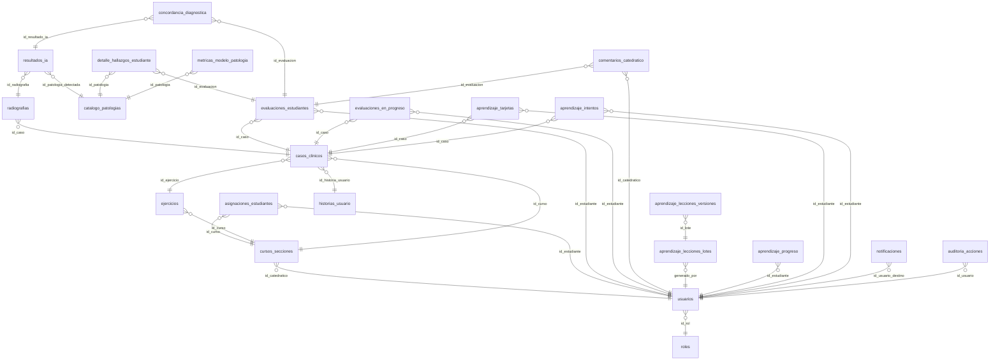
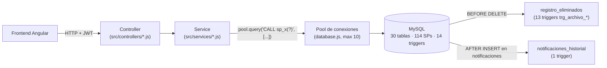

# Base de Datos de RADIA-OS — Tablas, Conexión, SPs y Triggers

Guía para entender cómo está armada la base de datos y cómo se conecta con el backend. Todo lo de aquí sale de inspeccionar el código real (`database.js`, `src/services/*.js`, `src/controllers/*.js`) y de consultar directamente `information_schema` de la base de datos (30 tablas, 114 procedimientos almacenados, 14 triggers).

> **Actualización (31/oct/2026):** nueva funcionalidad: (re)asignar a un estudiante sin curso, desde el admin o desde el catedrático, sin crear una cuenta nueva.
> - Admin (`gestion-usuarios`): botón "Asignar" en la tabla de "Estudiantes Sin Asignar a Docente", con un selector del curso/catedrático donde matricularlo. Usa `sp_obtener_catalogo_cursos`, que ya existía en producción (huérfano, nunca se había expuesto por la API) y ahora se expone en `GET /api/academico/admin/cursos` (solo admin).
> - Catedrático (`gestion-estudiantes-catedratico`): botón "Agregar Estudiante Existente" — busca por carnet o correo (no expone la lista completa de estudiantes sin asignar de la plataforma a cada docente) vía el SP nuevo `sp_buscar_estudiante_sin_asignar` (`GET /api/academico/buscar-estudiante-sin-asignar`), que rechaza la búsqueda si el estudiante no existe o si ya está asignado a algún curso.
> - `POST /api/academico/asignar` ahora exige `verificarRol(['catedratico', 'admin'])` — antes cualquier usuario autenticado, sin restricción de rol, podía llamarlo. También acepta `omitir_correo` para no disparar el correo de "bienvenida con clave temporal" cuando es una reasignación y el estudiante ya tiene su propia clave.
> 112 → **114 SPs** (2 nuevos: `sp_buscar_estudiante_sin_asignar`, `sp_obtener_catalogo_cursos`).
>
> **Actualización (16/oct/2026):** dos huecos de seguridad reales cerrados, encontrados al auditar "¿se puede vulnerar o eliminar al administrador?":
> - `POST /api/auth/registrar` era público y confiaba en el `id_rol` que mandaba el cliente — cualquiera, sin sesión, podía crearse una cuenta de administrador. Ahora exige token; un catedrático solo puede crear estudiantes, solo un admin puede crear cualquier rol.
> - `sp_eliminar_usuario` y `sp_editar_usuario_*` no tenían ninguna protección contra eliminar o quitarle el rol al **único** administrador del sistema (lo que lo hubiera dejado sin ningún admin y sin forma de recuperarse). Ahora lo bloquean con un mensaje claro; con 2+ administradores, cualquiera de ellos se puede eliminar o degradar sin problema. Mismos 3 SPs, sin cambiar el conteo total.
>
> **Actualización (15/oct/2026):**
> 9. Nueva funcionalidad: el docente puede eliminar un ejercicio completo (antes solo podía ocultarlo). Se creó `sp_eliminar_ejercicio` (borra en cascada todos los casos del ejercicio y lo que dependa de ellos, verificando que el ejercicio pertenezca a un curso del catedrático que lo pide — mismo patrón que `sp_ejercicio_cambiar_visibilidad`). 111 → **112 SPs**.
> 10. Al construir y probar esa funcionalidad se encontraron **2 bugs reales más**, introducidos sin querer el 14/oct al eliminar `pacientes_simulados` (no se habían detectado porque ese día no se probó el flujo de "componer y publicar ejercicio" ni un `DELETE` de caso real después del cambio):
>     - `sp_clonar_caso_a_curso` todavía intentaba insertar la columna `id_paciente` (ya eliminada de `casos_clinicos`) — rompía **todo** `POST /api/clinical/evaluaciones` (publicar un ejercicio desde el banco NIH) con `ER_BAD_FIELD_ERROR`.
>     - El trigger `trg_archivo_casos_clinicos` todavía referenciaba `OLD.id_paciente` en el `JSON_OBJECT` que archiva en `registro_eliminados` — rompía **cualquier** `DELETE` sobre `casos_clinicos`, incluido `DELETE /api/clinical/caso/:id` que ya existía antes de hoy.
>     
>     Ambos corregidos y probados de punta a punta en local y en producción (clonando un caso real del banco sin tocar el original, y confirmando que el trigger de archivado vuelve a funcionar).
>
> **Actualización (14/oct/2026, ocho cambios el mismo día):**
> 1. Se eliminaron 8 procedimientos que no tenían ningún uso en el backend (ver sección 6, más abajo). 123 → 115 SPs.
> 2. Se eliminó `src/config/dbDictionary.js` por completo: era la última excepción al patrón "todo por SP" (armaba SQL a mano en 4 servicios). Se crearon 7 SPs nuevos para reemplazarlo. 115 → 122 SPs.
> 3. Al revisar lo anterior se encontraron 2 SPs más (`sp_obtener_catalogo_rubricas`, `sp_obtener_catalogo_cuestionarios`) huérfanos desde que se borró `metricsService.js` en una limpieza previa del mismo día — se eliminaron también. 122 → 117 SPs.
> 4. Se eliminó la tabla `pacientes_simulados` por completo: se verificó contra producción que ningún caso clínico (de 3,322+ filas, banco NIH o asignados a un curso) tuvo nunca un paciente vinculado — la tabla quedó huérfana desde que el flujo real pasó a ser 100% "clonar del banco NIH". 5 SPs se reescribieron para quitarles esa referencia, 4 se eliminaron por quedar sin uso y 1 nuevo (`sp_editar_caso`) reemplazó a `sp_editar_caso_paciente`. 117 → 113 SPs, 36 → 35 tablas.
> 5. Se eliminaron `respuestas_likert`, `cuestionarios_percepcion` y `rubricas_definicion`: ningún archivo del backend, del frontend ni ningún SP las referenciaba — sus pocas filas (10/1/2) se habían insertado a mano, no por uso real. 35 → 32 tablas.
> 6. Se eliminó `auditoria_accesos`: se escribía en cada login (`sp_registrar_auditoria_acceso`) pero `GET /api/auth/auditoria` no tenía ningún consumidor en el frontend — el evento de login ya queda cubierto en `auditoria_acciones` (acción `INICIO_SESION`, con la IP incluida en el texto del mensaje), que sí se muestra en el panel de administrador. `sp_purgar_auditoria_antigua` se reescribió para purgar solo `auditoria_acciones`. 113 → 111 SPs, 32 → 31 tablas.
> 7. **Auditoría final de las 31 tablas restantes contra los 111 SPs**, cruzando cada tabla con las rutinas que la referencian: se encontró un **bug real preexistente** (no causado por limpiezas de hoy) — `sp_obtener_hallazgos_estudiante` (usado por "Retroalimentación IA", `POST /api/ia/inferencia`) hacía `JOIN` contra `localizacion_lesiones_estudiante`, una tabla que ya no existía en el esquema. Esto rompía **cada llamada** a ese endpoint con `ER_NO_SUCH_TABLE`, confirmado fallando en local y en producción. Se corrigió quitando el `JOIN` roto (el único campo que usa el código, `id_patologia`, no dependía de él) y se probó el flujo completo de punta a punta (inferencia real del modelo + cálculo de concordancia) en local y en producción.
> 8. Ese arreglo dejó huérfana a `regiones_anatomicas` (era su única referencia restante): 0 SPs, 0 código, 0 llaves foráneas, 0 triggers — se eliminó también. 111 SPs se mantienen igual, 31 → **30 tablas**, en local y en producción.

---

## 1. Cómo se conecta el backend a la base de datos

Archivo: `plataforma-radia-ia-backend/src/config/database.js`.

```js
const pool = mysql.createPool({
  host: process.env.DB_HOST,
  port: process.env.DB_PORT,
  user: process.env.DB_USER,
  password: process.env.DB_PASSWORD,
  database: process.env.DB_NAME,
  waitForConnections: true,
  connectionLimit: 10,
  queueLimit: 0,
  charset: 'utf8mb4_unicode_ci'
});
```

- Es un **pool de hasta 10 conexiones simultáneas** (no una conexión por petición): cada vez que un servicio hace `pool.query(...)`, toma una conexión libre del pool, la usa y la devuelve.
- El `charset` se fuerza a mano porque tu MariaDB local y el MySQL 8 de Railway traen collations por defecto distintas (`utf8mb4_unicode_ci` vs `utf8mb4_0900_ai_ci`); sin esto, algunos `CALL` a procedimientos tiraban error de "mezcla de collations" al comparar un parámetro del backend contra una columna de la tabla.
- Todos los servicios (`src/services/*.js`) importan este mismo `pool` con `const pool = require('../config/database')` — es un singleton, no se crea una conexión nueva por archivo.

### El patrón de acceso a datos: casi todo pasa por procedimientos almacenados

El backend **no arma sentencias SQL libres** (`SELECT * FROM tabla WHERE ...`) para leer o escribir datos de negocio. En su lugar, cada operación llama a un procedimiento con `pool.query('CALL sp_nombre(?, ?, ...)', [valores])`. Esto evita inyección SQL por diseño (los parámetros siempre van como placeholders `?`, nunca concatenados) y centraliza la lógica de consultas complejas dentro de MySQL en vez de repetirla en JavaScript.

**Excepción:** 4 endpoints llaman procedimientos directamente desde el controlador (3 en `diagnosticoController.js`, 1 en `clinicalController.js`) en vez de pasar por un `service` — son casos puntuales, no cambia el patrón general de usar SPs.

**`dbDictionary.js` (eliminado el 14/oct/2026):** existía un archivo que definía constantes con los nombres de tablas/columnas (`dict.TABLAS.NOTIFICACIONES`, etc.) y lo usaban 4 servicios para armar `INSERT`/`SELECT` a mano en vez de un SP — la única excepción real al patrón "todo por SP" en todo el proyecto. Se creó un SP para cada una de esas operaciones (`sp_notificacion_crear`, `sp_notificaciones_listar`, `sp_comentario_crear`, `sp_comentarios_listar_evaluacion`, `sp_config_correo_activa`, `sp_plantilla_correo`, `sp_ficha_ia_patologia`) y se borró el archivo. Hoy **el 100% del acceso a datos de negocio pasa por procedimientos almacenados** (salvo los 4 llamados directos desde un controlador mencionados arriba, que también son SPs, solo que sin pasar por un `service` intermedio).

---

## 2. Las 30 tablas, agrupadas por para qué sirven

### A) Usuarios, roles y auditoría

| Tabla | Para qué sirve |
|---|---|
| `usuarios` | Cuenta de cada persona: estudiante, catedrático o admin. Guarda el hash de la contraseña (nunca el texto plano), si debe cambiar su clave al entrar, y el `codigo_docente` único que usan los estudiantes para auto-registrarse con su docente. |
| `roles` | Catálogo fijo de los 3 roles del sistema (estudiante, catedrático, admin). |
| `auditoria_acciones` | Bitácora general de acciones importantes del sistema (login/logout, editar caso, eliminar caso, etc.), con un texto libre describiendo qué pasó — incluida la IP en los eventos de inicio de sesión. Se purga automáticamente lo de más de 30 días. |
| `registro_eliminados` | Papelera de seguridad: antes de borrar una fila de las tablas "sensibles" (ver §4, triggers `trg_archivo_*`), se guarda aquí una copia completa en formato JSON, por si algún día hay que auditar qué se borró. |

### B) Gestión académica (cursos y matrícula)

| Tabla | Para qué sirve |
|---|---|
| `cursos_secciones` | Un curso/sección que pertenece a un catedrático (ej. "Radiología I, 2026"). |
| `catalogo_cursos` | Lista maestra de nombres de curso disponibles para elegir al crear uno nuevo (evita que cada docente escriba el nombre distinto). |
| `asignaciones_estudiantes` | La matrícula: qué estudiante pertenece a qué curso. Es la tabla que conecta estudiantes con docentes (de forma indirecta, vía el curso). |
| `ejercicios` | Un "paquete" de casos clínicos que el docente publica para su curso (ej. "Ejercicio 3"). Tiene un flag `oculto` para esconderlo sin borrarlo. |

### C) Casos clínicos y el banco de imágenes

| Tabla | Para qué sirve |
|---|---|
| `casos_clinicos` | El caso que el estudiante va a resolver: motivo de consulta, nivel de dificultad, si viene del banco NIH o lo creó un docente, y los `hallazgos_docente` (la "verdad" de referencia, en JSON) contra la que se califica. |
| `radiografias` | La imagen subida/asociada a un caso, con su ruta de archivo y tipo de proyección. |
| `historias_usuario` | Frases de "motivo de consulta" reutilizables por patología/género, para redactar casos del banco NIH sin escribir cada uno a mano. |
| `catalogo_patologias` | Las 8 patologías del modelo de IA, con su descripción y la ficha ampliada generada con IA (`ficha_ia_json`). |
| `distractores` | Para cada patología, con cuáles otras se confunde más — se usa para armar opciones "trampa" en la práctica guiada. |

### D) Evaluaciones y resultados

| Tabla | Para qué sirve |
|---|---|
| `evaluaciones_estudiantes` | La respuesta del estudiante a un caso: qué marcó, su justificación clínica, nivel de confianza, tiempo que tardó, y los 3 ejes de calificación (`eje1_diagnostico`, `eje2_localizacion`, `eje3_calibracion`). |
| `evaluaciones_en_progreso` | Cronómetro persistente: cuántos segundos lleva un estudiante en un caso que **todavía no ha respondido**, para poder retomarlo si sale y vuelve a entrar. Se borra en cuanto responde. |
| `detalle_hallazgos_estudiante` | Cada patología individual que el estudiante marcó dentro de una evaluación (una evaluación puede tener varios hallazgos). |
| `resultados_ia` | El veredicto del modelo de IA sobre una radiografía (patología detectada, probabilidad, ruta del mapa de calor Grad-CAM). Es un módulo aparte de "Retroalimentación IA", no interviene en la calificación del estudiante. |
| `concordancia_diagnostica` | Qué tanto coincidió el diagnóstico del estudiante con el de la IA (nivel Alta/Media/Baja), para la pantalla de retroalimentación. |
| `metricas_modelo_patologia` | Métricas reales y fijas del modelo entrenado (AUC, % de localización, si el modelo se abstiene siempre en esa patología) — contexto para que el estudiante sepa qué tan confiable es la IA en cada caso. |

### E) Aprendizaje dirigido (lecciones, práctica guiada, repaso espaciado)

| Tabla | Para qué sirve |
|---|---|
| `aprendizaje_lecciones_lotes` | Una "ficha" o tanda de generación: cuando el docente le pide a la IA que genere lecciones, se agrupan en un lote. |
| `aprendizaje_lecciones_versiones` | El contenido real de cada lección (una por patología), con su estado (`borrador`/`aprobado`) y si está `activo` (la que ven los estudiantes ahora mismo). Puede haber varias versiones históricas de la misma patología; solo una está activa a la vez. |
| `aprendizaje_progreso` | Qué tanto avanzó un estudiante en la lección de una patología (si vio la lección, si vio el comparador) — guardado **por versión específica**, para que el progreso no se pierda si el docente activa una ficha distinta. |
| `aprendizaje_tarjetas` | Las tarjetas de repaso espaciado (algoritmo FSRS) de cada estudiante: cuándo le toca repasar un caso de nuevo según qué tan bien le fue la última vez. |
| `aprendizaje_intentos` | Historial de cada intento del estudiante en práctica guiada o repaso (qué marcó, qué era, si acertó, si usó pista). Alimenta la matriz de errores personal. |
| `aprendizaje_explicaciones` | Explicación de "por qué te equivocaste" generada por IA o plantilla para un par específico (ej. "marcaste Neumonía, era Atelectasia"), pendiente de aprobación docente antes de mostrarse. |

### F) Comunicación (notificaciones y comentarios)

| Tabla | Para qué sirve |
|---|---|
| `notificaciones` | La notificación "viva" que lee la campanita de cada usuario (hasta 100 más recientes). Nunca se borra manualmente, pero si se elimina el usuario destino, se borra en cascada con él. |
| `notificaciones_historial` | Copia permanente e independiente de cada notificación creada, generada automáticamente por un trigger (ver §4) — sobrevive aunque el usuario o la notificación original se borren. Hoy nadie la consulta desde la interfaz, solo se está guardando. |
| `comentarios_catedratico` | Comentarios que el docente deja sobre la respuesta de un estudiante a un caso. |

### G) Configuración de correo (infraestructura, no datos de negocio)

| Tabla | Para qué sirve |
|---|---|
| `configuracion_correos` | Datos del proveedor SMTP usado para enviar correos (host, puerto, usuario, contraseña de app). |
| `plantillas_correos` | Plantillas HTML reutilizables para los correos automáticos (bienvenida, registro), con las variables que aceptan. |

> **`cuestionarios_percepcion`, `respuestas_likert` y `rubricas_definicion`** existían como catálogos sin ningún código que las tocara (ni backend, ni frontend, ni un solo SP) — se eliminaron el 14/oct/2026, ver la actualización al inicio del documento.

---

## 3. El diagrama de relaciones



`notificaciones_historial` queda deliberadamente **fuera** de este diagrama: no tiene llave foránea hacia `usuarios` (a propósito, para que el historial sobreviva aunque se borre el usuario o la notificación original).

---

## 4. Los 14 triggers

| Trigger | Se dispara | Qué hace |
|---|---|---|
| `trg_notificaciones_al_crear` | `AFTER INSERT` en `notificaciones` | Copia automáticamente la notificación nueva a `notificaciones_historial` — es el mecanismo que mantiene el historial permanente sin que el backend tenga que acordarse de hacerlo. |
| `trg_archivo_usuarios` | `BEFORE DELETE` en `usuarios` | Guarda una copia JSON de la fila en `registro_eliminados` antes de borrarla. |
| `trg_archivo_cursos_secciones` | `BEFORE DELETE` en `cursos_secciones` | Igual, para cursos. |
| `trg_archivo_asignaciones_estudiantes` | `BEFORE DELETE` en `asignaciones_estudiantes` | Igual, para matrículas. |
| `trg_archivo_ejercicios` | `BEFORE DELETE` en `ejercicios` | Igual, para ejercicios. |
| `trg_archivo_casos_clinicos` | `BEFORE DELETE` en `casos_clinicos` | Igual, para casos clínicos. |
| `trg_archivo_radiografias` | `BEFORE DELETE` en `radiografias` | Igual, para radiografías. |
| `trg_archivo_evaluaciones_estudiantes` | `BEFORE DELETE` en `evaluaciones_estudiantes` | Igual, para evaluaciones. |
| `trg_archivo_detalle_hallazgos_estudiante` | `BEFORE DELETE` en `detalle_hallazgos_estudiante` | Igual, para hallazgos. |
| `trg_archivo_comentarios_catedratico` | `BEFORE DELETE` en `comentarios_catedratico` | Igual, para comentarios. |
| `trg_archivo_catalogo_patologias` | `BEFORE DELETE` en `catalogo_patologias` | Igual, para el catálogo de patologías. |
| `trg_archivo_aprendizaje_progreso` | `BEFORE DELETE` en `aprendizaje_progreso` | Igual, para progreso de aprendizaje. |
| `trg_archivo_aprendizaje_tarjetas` | `BEFORE DELETE` en `aprendizaje_tarjetas` | Igual, para tarjetas de repaso. |
| `trg_archivo_aprendizaje_intentos` | `BEFORE DELETE` en `aprendizaje_intentos` | Igual, para intentos de práctica. |

**En resumen:** 13 de los 14 triggers son el mismo patrón repetido ("antes de borrar, archiva una copia") aplicado a las 13 tablas que se consideran con datos valiosos de auditar; el único trigger distinto es el de notificaciones, que no archiva un borrado sino que replica cada creación.

---

## 5. Los 114 procedimientos almacenados, agrupados por módulo

Cada uno indica desde qué `service`/función del backend se llama y para qué sirve. Casi todos se invocan con `pool.query('CALL sp_nombre(?, ?)', [valores])`; solo 4 se llaman directo desde un controlador en vez de pasar por un `service`.

### 5.1 Autenticación y usuarios (`authService.js`, `userService.js`, `codigoDocenteService.js`) — 18 SPs

| SP | Se usa en | Para qué |
|---|---|---|
| `sp_verificar_correo_existe` | `registrarUsuario`, `registrarEstudiante` | Evita correos duplicados antes de registrar |
| `sp_registrar_usuario` | `registrarUsuario`, `registrarEstudiante` | Inserta el usuario nuevo |
| `sp_marcar_clave_temporal` | `registrarUsuario` | Marca que debe cambiar su clave (cuenta creada por otra persona) |
| `sp_crear_curso_catalogo` | `registrarUsuario` | Agrega/reutiliza el nombre del curso al registrar un catedrático |
| `sp_asignar_curso_inicial` | `registrarUsuario` | Crea la primera sección del catedrático nuevo |
| `sp_marcar_clave_definitiva` | `registrarDocente`, `registrarEstudiante` | Quita el flag de clave temporal (auto-registro público) |
| `sp_obtener_docente_por_codigo` | `buscarDocentePorCodigo` | Busca al docente dueño de un código y sus cursos |
| `sp_verificar_carnet_existe` | `registrarEstudiante` | Evita carnets duplicados |
| `sp_obtener_usuario_por_correo` | `loginUsuario` | Trae el usuario (hash + rol) para el login |
| `sp_cambiar_clave_inicial` | `cambiarClaveInicial` | Guarda la nueva contraseña al cambiar la clave temporal |
| `sp_obtener_roles` | `obtenerRoles` | Catálogo de roles |
| `sp_obtener_lista_usuarios` | `obtenerUsuarios` | Lista de usuarios (vista de `authService`) |
| `sp_asignar_codigo_docente` | `asignarCodigoNuevo` | Genera/asigna un código único de docente |
| `sp_obtener_codigo_docente` | `obtenerCodigo` | Trae el código actual de un docente |
| `sp_listar_usuarios_completos` | `userService.listarUsuarios` | Lista completa de usuarios (panel admin) |
| `sp_editar_usuario_con_password` | `userService.editarUsuario` | Edita usuario y cambia su contraseña |
| `sp_editar_usuario_sin_password` | `userService.editarUsuario` | Edita usuario sin tocar la contraseña |
| `sp_eliminar_usuario` | `userService.eliminarUsuario` | Elimina un usuario |

### 5.2 Gestión académica (`academicService.js`) — 19 SPs

| SP | Se usa en | Para qué |
|---|---|---|
| `sp_crear_curso` | `crearCurso` | Crea un curso |
| `sp_verificar_estudiante_curso` | `asignarEstudiante` | Verifica si ya está matriculado |
| `sp_asignar_estudiante_curso` | `asignarEstudiante`, `registrarEstudiante` | Matricula al estudiante |
| `sp_obtener_info_correo_asignacion` | `asignarEstudiante` | Datos para el correo de bienvenida |
| `sp_obtener_cursos_catedratico` | `obtenerCursosCatedratico` + validaciones "¿es tu curso?" en `clinicalService`/`informeService` | Lista cursos de un docente |
| `sp_obtener_nombres_cursos_disponibles` | `obtenerCatalogoCursos` | Catálogo maestro de nombres de curso |
| `sp_obtener_estudiantes_por_curso` | `obtenerEstudiantesPorCurso` | Estudiantes matriculados |
| `sp_obtener_estadisticas_curso` | `obtenerEstadisticas` | Estadísticas de un curso |
| `sp_obtener_total_casos_catedratico` | `obtenerResumenGeneral` | Total de casos asignados (dashboard) |
| `sp_obtener_estudiantes_resumen_catedratico` | `obtenerResumenGeneral` | Resumen por alumno |
| `sp_obtener_detalle_estudiante_usuario` | `obtenerDetalleEstudiante`, `obtenerMiRendimiento` | Datos básicos del expediente |
| `sp_obtener_detalle_estudiante_evaluaciones` | `obtenerDetalleEstudiante`, `obtenerMiRendimiento` | Historial de evaluaciones del estudiante |
| `sp_editar_estudiante_basico` | `editarEstudiante` | Edita nombre/correo |
| `sp_eliminar_estudiante_curso` | `eliminarEstudiante` | Desasigna/elimina al estudiante |
| `sp_obtener_mi_rendimiento_estadisticas` | `obtenerMiRendimiento` | Estadísticas propias del estudiante |
| `sp_editar_curso` | `editarCurso` | Edita un curso |
| `sp_eliminar_curso` | `eliminarCurso` | Elimina un curso (falla si tiene datos asociados) |
| `sp_buscar_estudiante_sin_asignar` | `buscarEstudianteSinAsignar` | Busca un estudiante por carnet/correo para que el catedrático lo reasigne a su curso; rechaza si no existe o si ya está asignado a algún curso |
| `sp_obtener_catalogo_cursos` | `obtenerCatalogoCursosAdmin` | Catálogo de cursos con su catedrático y total de alumnos, para que el admin elija dónde reasignar a un estudiante sin curso |

### 5.3 Casos clínicos (`clinicalService.js`) — 25 SPs

> El módulo `radiografiaService.js` (flujo duplicado y sin uso) y la tabla `pacientes_simulados` (huérfana, ver la actualización del 14/oct al inicio del documento) se eliminaron el mismo día — ver `MODULOS_POR_ROL.md`. Todos los SPs de este bloque los llama únicamente `clinicalService.js`.

| SP | Se usa en | Para qué |
|---|---|---|
| `sp_obtener_casos_detallados` | `obtenerCasosDetallados` | Lista de casos (gestión docente) |
| `sp_obtener_detalle_caso` | `obtenerDetalleCaso` | Detalle completo de un caso (vista docente) |
| `sp_editar_caso` | `editarCaso` | Edita título/motivo/nivel de un caso |
| `sp_eliminar_caso` | `eliminarCaso` | Elimina un caso (cascada) |
| `sp_crear_ejercicio` | `asignarCasosBanco` | Crea un "Ejercicio N" nuevo |
| `sp_clonar_caso_a_curso` | `asignarCasosBanco` | Clona un caso del banco NIH al curso |
| `sp_asignar_historia_aleatoria` | `asignarCasosBanco` | Asigna una historia de consulta al azar |
| `sp_contar_casos_banco_nih` | `componerEjercicio`, `obtenerDisponibilidadBanco` | Cuenta casos del banco que cumplen filtros |
| `sp_listar_casos_banco_nih` | `componerEjercicio` | Trae la página de casos del banco que cumplen filtros |
| `sp_obtener_metricas_modelo` | `obtenerMetricasModelo` | Métricas del modelo por patología |
| `sp_obtener_resumen_estudiante_edu` | `obtenerEstadisticasEstudiante` | Casos resueltos y precisión del estudiante |
| `sp_obtener_caso_estudiante_raw` | `obtenerCasoEstudianteSeguro` | Trae el caso crudo (se filtra antes de responder) |
| `sp_obtener_tiempo_progreso` | `obtenerCasoEstudianteSeguro` | Tiempo ya acumulado en un caso sin responder |
| `sp_guardar_tiempo_progreso` | `guardarTiempoProgreso` | Guarda el cronómetro mientras no responde |
| `sp_existe_evaluacion_estudiante` | `guardarRespuestaEstudiante` | Evita responder dos veces el mismo caso |
| `sp_crear_evaluacion_estudiante_edu` | `guardarRespuestaEstudiante` | Crea la cabecera de la evaluación |
| `sp_crear_detalle_hallazgo` | `guardarRespuestaEstudiante` | Guarda cada patología marcada |
| `sp_eliminar_tiempo_progreso` | `guardarRespuestaEstudiante` | Limpia el cronómetro al terminar |
| `sp_obtener_verdad_caso` | `guardarRespuestaEstudiante` | Verdad de referencia para calificar |
| `sp_actualizar_puntajes_evaluacion` | `guardarRespuestaEstudiante` | Guarda los 3 ejes calculados |
| `sp_obtener_retroalimentacion_estudiante` | `obtenerRetroalimentacionEstudiante` | Respuesta + verdad + opinión IA |
| `sp_ejercicios_progreso_catedratico` | `obtenerProgresoEjercicios` | Estado de cada ejercicio para el docente |
| `sp_ejercicio_bitacora` | `obtenerBitacoraEjercicio` | Qué alumno completó qué |
| `sp_ejercicio_cambiar_visibilidad` | `cambiarVisibilidadEjercicio` | Oculta/muestra un ejercicio |
| `sp_eliminar_ejercicio` | `eliminarEjercicio` | Elimina un ejercicio completo con todos sus casos (cascada), verificando que sea del catedrático que lo pide (nuevo, 15/oct) |
| `sp_obtener_worklist_estudiante` | `clinicalController.obtenerWorklist` (directo, sin `service`) | Casos pendientes/completados del estudiante |
| `sp_ficha_ia_patologia` | `generarInfoPatologia` | Ficha generada con IA de una patología (nuevo, reemplaza el `SELECT` armado con `dbDictionary`) |

### 5.4 Catálogo de patologías (`diagnosticoController.js`, llamadas directas) — 3 SPs

> `diagnosticoService.js` (el flujo "mock" de diagnóstico, `POST /diagnostico/evaluar`) se eliminó el 14/oct/2026 por no tener ningún consumidor real — con él se fueron `sp_crear_evaluacion_cabecera`, `sp_crear_localizacion_lesion` y `sp_obtener_catalogo_regiones`. Lo único que queda vivo de este módulo es el CRUD del catálogo de patologías, llamado directo desde el controlador.

| SP | Se usa en | Para qué |
|---|---|---|
| `sp_obtener_catalogo_patologias` | `listarCatalogos` (directo) y `clinicalService.guardarRespuestaEstudiante` | Catálogo de patologías |
| `sp_editar_patologia` | `editarPatologia` (directo) | Edita una patología del catálogo |
| `sp_eliminar_patologia` | `eliminarPatologia` (directo) | Elimina una patología |

### 5.5 Inferencia de IA (`iaService.js`) — 3 SPs

| SP | Se usa en | Para qué |
|---|---|---|
| `sp_obtener_ruta_radiografia` | `procesarResultadoYConcordancia` | Ruta del archivo a inferir |
| `sp_obtener_hallazgos_estudiante` | `procesarResultadoYConcordancia` | Lo que marcó el estudiante, para comparar |
| `sp_guardar_resultado_ia_y_concordancia` | `procesarResultadoYConcordancia` | Guarda veredicto IA + % de concordancia |

### 5.6 Aprendizaje — lado estudiante (`aprendizajeService.js`) — 15 SPs

| SP | Se usa en | Para qué |
|---|---|---|
| `sp_apr_explicacion` | `explicacionDelPar` | Explicación aprobada de un error específico |
| `sp_apr_tarjeta` | `programarTarjeta`, `sincronizarTarjetas`, `obtenerMisErrores` | Tarjeta de repaso espaciado |
| `sp_apr_guardar_tarjeta` | `programarTarjeta` | Guarda la tarjeta reprogramada |
| `sp_apr_evaluaciones_estudiante` | `sincronizarTarjetas`, `obtenerMisErrores` | Respuestas que salieron mal, para tarjeta |
| `sp_apr_progreso` | `obtenerResumen`, `obtenerRepaso` | Progreso por patología |
| `sp_apr_leccion` | `obtenerLeccion` | Contenido aprobado de la lección activa |
| `sp_apr_reiniciar_clase` | `reiniciarClase` | Borra progreso/historial de una patología |
| `sp_apr_marcar_paso` | `marcarPaso` | Marca "lección vista"/"comparador visto" |
| `sp_apr_ejemplo_comparador` | `ejemploComparador` | Caso ejemplo para el comparador |
| `sp_apr_casos_practica` | `casosPractica` | Casos disponibles para práctica guiada |
| `sp_apr_intentos_estudiante` | `obtenerSesionGuiada`, `obtenerMisErrores` | Historial de intentos |
| `sp_apr_caso_practica` | `responder` (práctica guiada) | Revela la verdad de un caso de práctica |
| `sp_apr_caso_tarjeta` | `responder` (repaso) | Revela la verdad de un caso en repaso |
| `sp_apr_registrar_intento` | `responder` | Guarda el intento del estudiante |
| `sp_apr_tarjetas_vencidas` | `obtenerRepaso` | Tarjetas vencidas para la sesión de repaso |

### 5.7 Aprendizaje — lado docente/IA (`aprendizajeAdminService.js`, `config/catalogoLecciones.js`) — 9 SPs

| SP | Se usa en | Para qué |
|---|---|---|
| `sp_apr_lecciones_admin` | `listarLecciones`, `cargarLecciones` (caché en memoria al arrancar) | Lista lecciones activas |
| `sp_apr_guardar_leccion` | `guardarLeccion` | Guarda/aprueba contenido de una lección |
| `sp_apr_crear_version_leccion` | `generarCandidatasEnLote` | Inserta una candidata generada por IA |
| `sp_apr_crear_lote_leccion` | `generarLecciones` | Crea un lote nuevo de hasta 8 candidatas |
| `sp_apr_listar_lotes_leccion` | `listarLotesLeccion` | Lista los lotes de generación |
| `sp_apr_listar_versiones_lote` | `listarVersionesLote`, `completarLoteLeccion`, `publicarLoteLeccion` | Versiones/candidatas de un lote |
| `sp_apr_eliminar_lote_leccion` | `eliminarLoteLeccion` | Borra un lote (falla si tiene versión publicada) |
| `sp_apr_explicaciones_admin` | `listarExplicaciones` | Explicaciones pendientes de revisión |
| `sp_apr_revisar_explicacion` | `revisarExplicacion` | Aprueba/rechaza una explicación |

### 5.8 Notificaciones (`notificationService.js`) — 8 SPs

| SP | Se usa en | Para qué |
|---|---|---|
| `sp_notificacion_crear` | `crearNotificacion`, `enviarNotificacionMasiva` (en bucle, una llamada por destinatario) | Inserta una notificación (nuevo, reemplaza el `INSERT` armado con `dbDictionary`) |
| `sp_notificaciones_listar` | `obtenerNotificaciones` | Las 100 notificaciones más recientes de un usuario (nuevo, mismo reemplazo) |
| `sp_marcar_notificacion_leida` | `marcarLeida` | Marca una notificación como leída |
| `sp_marcar_todas_notificaciones_leidas` | `marcarTodasLeidas` | Marca todas como leídas |
| `sp_datos_curso_notificacion` | 4 funciones de notificación de curso | Nombre de curso / id del catedrático |
| `sp_ids_estudiantes_curso` | `notificarEjercicioPublicado`, `notificarEjercicioEliminado` | Ids de estudiantes para notificación masiva |
| `sp_progreso_ejercicio_estudiante` | `notificarProgresoDelEstudiante` | Si el estudiante completó todo el ejercicio |
| `sp_dueno_evaluacion` | `notificarComentarioDelDocente` | A quién notificarle un comentario |

### 5.8b Comentarios del docente (`commentService.js`) — 2 SPs

> Nuevo módulo documentado: antes estas 2 operaciones armaban SQL a mano con `dbDictionary` y no tenían SP propio.

| SP | Se usa en | Para qué |
|---|---|---|
| `sp_comentario_crear` | `agregarComentario` | Inserta el comentario del docente sobre una evaluación |
| `sp_comentarios_listar_evaluacion` | `obtenerComentariosEvaluacion` | Lista los comentarios de una evaluación, con el nombre del docente |

### 5.8c Correo (`emailService.js`) — 2 SPs

> Nuevo módulo documentado, mismo motivo que el anterior.

| SP | Se usa en | Para qué |
|---|---|---|
| `sp_config_correo_activa` | `obtenerConfigSmtp` | Trae la configuración SMTP activa |
| `sp_plantilla_correo` | `obtenerPlantilla` | Trae la plantilla HTML de un evento (bienvenida, registro, etc.) |

### 5.9 Auditoría (`auditService.js`) — 3 SPs

| SP | Se usa en | Para qué |
|---|---|---|
| `sp_registrar_auditoria_actividad` | `registrarAccion` | Registra una acción en el log |
| `sp_obtener_logs_actividad` | `obtenerLogs` | Lista el log de actividad |
| `sp_purgar_auditoria_antigua` | `purgarAntiguos` (job cada 24 h) | Borra accesos/acciones de más de 30 días |

### 5.10 Informes PDF (`informeService.js`, `informeEstudianteService.js`) — 3 SPs

| SP | Se usa en | Para qué |
|---|---|---|
| `sp_listar_ejercicios_catedratico` | `obtenerEjerciciosDocente` | Ejercicios del docente, para el informe grupal |
| `sp_informe_calificaciones` | `obtenerDatosInforme` | Calificaciones por estudiante/ejercicio |
| `sp_informe_estudiante` | `obtenerDatos` | Datos + evaluaciones de un estudiante |

### 5.11 Administración — 1 SP

> `metricsService.js` (el único consumidor de `sp_obtener_catalogo_rubricas` y `sp_obtener_catalogo_cuestionarios`) se eliminó el 14/oct/2026 por no tener ningún consumidor real en el frontend — esos 2 SPs quedaron huérfanos y se eliminaron también ese mismo día.

| SP | Se usa en | Para qué |
|---|---|---|
| `sp_admin_resumen_global` | `adminService.obtenerResumenGlobal` | KPIs globales del panel de administrador |

### 5.12 Configuración en memoria (`config/distractores.js`) — 1 SP

| SP | Se usa en | Para qué |
|---|---|---|
| `sp_obtener_distractores` | `cargarDistractores` (al arrancar el servidor) | Carga en memoria qué patologías se confunden entre sí |

---

## 6. Los 8 procedimientos sin uso — eliminados el 14/oct/2026

Estaban creados en la base de datos, pero ningún archivo del backend los llamaba (se verificó con una búsqueda exhaustiva en todo el repositorio, no solo en `services`/`controllers`, y también se confirmó que ningún otro SP ni trigger los llamaba internamente). Se eliminaron de local y producción con `db_backups/cambios_bd_railway_eliminar_sps_sin_uso.sql`:

| SP eliminado | Por qué no se usaba |
|---|---|
| `sp_agregar_feedback_evaluacion` | Resabio de una versión anterior del "comentario del docente", que terminó implementándose distinto (hoy es `comentarios_catedratico` + `sp_dueno_evaluacion`/`notificarComentarioDelDocente`) |
| `sp_crear_caso_completo` | Parecía una versión "todo en uno" (paciente + caso + radiografía) que el código terminó haciendo con 3 SPs separados en su lugar |
| `sp_eliminar_ejercicio` (versión vieja) | El código solo *oculta* ejercicios (`sp_ejercicio_cambiar_visibilidad`); nunca borró uno completo — **nota:** el 15/oct se creó un SP nuevo con este mismo nombre para la funcionalidad real de "eliminar ejercicio" (ver sección 5.3); es una coincidencia de nombre, no el mismo procedimiento |
| `sp_guardar_calificacion_rubrica` | No hay flujo de calificación por rúbrica conectado |
| `sp_invalidar_evaluacion` | No existe ningún endpoint para anular una evaluación ya registrada |
| `sp_obtener_calificaciones_evaluacion` | Sin uso detectado |
| `sp_obtener_evaluaciones_curso` | Sin uso detectado (lo más parecido conectado es `sp_informe_calificaciones`) |
| `sp_obtener_todas_evaluaciones` | Sin uso detectado |

La base de datos quedó en **115 procedimientos**, verificado en local y en producción tras el despliegue.

---

## 7. El flujo completo, de un vistazo



El backend nunca toca las tablas directamente en la mayoría de los casos: pasa por el SP correspondiente, y es MySQL quien, además, dispara los triggers de archivado/historial sin que el backend tenga que acordarse de hacerlo.
